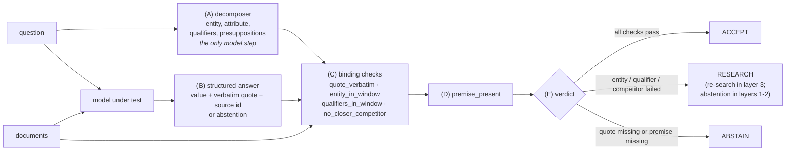

# binding-gate

A deterministic verification gate for LLM agents that answer questions from web
search or retrieved documents, and the pre-registered study that is meant to
test it.

> **Status: pre-registration DRAFT. Nothing has been measured.** No model has
> been called, no API key is connected yet, and there is no result of any kind:
> no baseline rate, no evidence that the gate works. Every number in
> [PREREGISTRATION.md](PREREGISTRATION.md) marked **PROPOSED** (thresholds,
> seeds, window sizes, budget caps, sample sizes) still needs the owner's
> approval before the plan is frozen. The model clients have been tested only
> against recorded-shape example responses; model ids and prices in the configs
> are not yet confirmed against the live APIs.

## The failure studied

An agent finds a real, on-topic source and quotes a detail that really is in
that source, but the detail belongs to a *different entity* or to *different
conditions* than the question asked about: the dose of another drug, the figure
for another year, the limit for another product version. The answer is quoted,
sourced and wrong. The Deceptive Grounding paper
([arXiv 2607.09349](https://arxiv.org/abs/2607.09349)) calls this
*entity-attribution failure*.

Claim-versus-source checkers ask "is the claim supported by the source?" — here
it is. binding-gate asks a different question: **is the evidence about the same
entity and qualifiers as the question?**

## The gate in one diagram



Steps (C), (D) and (E) are plain code: same input, same output, no model call,
no randomness, no document ids or gold labels. The exact rules are in
PREREGISTRATION.md section 5.1. Abstentions and unparseable answers pass the
gate unchanged, so it cannot hide format failures.

## How it will be evaluated

Written down before any experiment in [PREREGISTRATION.md](PREREGISTRATION.md):

- **H1** the gate reduces wrong-entity answers; **H2** at a bounded loss of
  correct answers; **H3** it does better than an existing open-source
  faithfulness checker (MiniCheck); **H4** with live web search and a re-search
  loop, net correct answers do not drop. Rules and thresholds: section 11.
- **Layers:** (1) the Deceptive Grounding benchmark, confirmatory for H1-H3;
  (2) GRAB-RAG, exploratory; (3) a live-web layer on SealQA, confirmatory for
  H4 (see "Live web" below).
- **Scoring is deterministic:** every arm must return value + quote + source;
  the quote is matched against the shown documents to decide whose document it
  came from. An LLM judge is only a secondary cross-check.
- **Dev/test split by hash**, a test-set lock with a committed, hash-chained
  access log, cluster-bootstrap intervals, a stop rule after the baseline, a
  human audit of 100 gate decisions, and a public report with fixed contents
  (section 15).

The code is organised as described in [ARCHITECTURE.md](ARCHITECTURE.md).

### Live web (layer 3)

- **Questions:** SealQA's `seal_hard` subset (Hugging Face `vtllms/sealqa`,
  pinned revision; Seal-0 questions are labelled so they can be reported
  separately), downloaded and hash-checked by `python -m binding_gate.cli
  dataset-prepare`. Correctness is decided by the deterministic scorer
  `sealqa_answer` (the gold answer must occur in the answer's value).
- **Search and pages:** the harness, not the model, chooses every query. It
  searches the question with **SerpApi** (Google engine, `hl=en`, `gl=us`,
  at most 10 results), fetches result pages in rank order until 5 were fetched
  (robots.txt respected, HTML and plain text only) and shows the first 8,000
  characters of each. `no_gate_live` stops there; `gated_research` applies the
  decomposer and the gate to the same candidate and, on RESEARCH, issues one
  targeted re-search (`"<entity>" <qualifiers> <attribute>`) and judges the new
  answer. All these values are PROPOSED.
- **Snapshots:** every search response, robots.txt and page is stored at fetch
  time under `runs/<run_id>/snapshots/`, named by its SHA-256 and made
  read-only; the gate and the scorer only ever see documents rebuilt from the
  stored text, and `python -m binding_gate.research.snapshots verify
  runs/<run_id>` re-checks every hash. Layer 3 is reproducible from snapshots,
  not re-runnable (the web changes).
- **Encryption of artifacts:** page text is third-party material, and traces
  contain it (prompts are traced). The workflow therefore uploads a live-web
  run directory only encrypted (GnuPG, AES-256, passphrase from the repository
  secret `RUNS_ENCRYPTION_PASSPHRASE`; a paid live-web run refuses without it),
  next to an unencrypted publish manifest of URLs, times, HTTP status and
  hashes without any page text (PREREGISTRATION.md section 14).

## Running each step

Requires Python 3.11 or newer and git. The core package has no runtime
dependencies.

```bash
python -m pip install -e ".[dev]"     # add ",plots" for figures (matplotlib)
python -m pytest                      # no network, no keys, no model calls
```

Every run is one versioned config file under `configs/`, selected by its path.
Experiment settings are never read from environment variables; only API keys
are (`src/binding_gate/secrets.py` is the single place). Benchmarks are cloned
by you into `data/raw/` (git-ignored) at the pinned commits; nothing is
redistributed. In GitHub, the manually started workflow **baseline**
(`.github/workflows/baseline.yml`) runs the dev runs with keys from repository
secrets. **The full operating sequence**, from adding the secrets to the
frozen test run and the public report, with the exact run-dialog values for
every workflow step and the exact command for every command-line-only step, is
in [docs/RUNNING.md](docs/RUNNING.md) (English and Hebrew; the first steps also
in [docs/RUNNING_BASELINE.md](docs/RUNNING_BASELINE.md)).

| Step | Command (all paid commands refuse without `--confirm-spend`) |
|---|---|
| Dry run: calls and cost estimate, no API call, no key | `python -m binding_gate.cli dry-run --config configs/dev_smoke.toml` |
| Free check that each model id exists | `python -m binding_gate.cli preflight --config configs/dev_smoke.toml` |
| Smoke run (1 dev group, 1 repeat, all seven models) | `python -m binding_gate.cli run --config configs/dev_smoke.toml --confirm-spend` |
| Dev baseline, `no_gate` (section 10) | `python -m binding_gate.cli run --config configs/dev_baseline.toml --confirm-spend` |
| Stop-rule report from traces | `python -m binding_gate.cli report runs/<run_id> --json baseline.json` |
| Decomposer accuracy (section 7) | `python -m binding_gate.evaluation.decomposer dry-run\|run\|report --config configs/decomposer_eval_dev.toml` |
| Gated arm on dev | `python -m binding_gate.cli run --config configs/dev_gated.toml --confirm-spend` |
| Gate calibration on dev traces (no model calls) | `python -m binding_gate.gates.calibration runs/<run_id> ...` |
| Later dev runs reuse the baseline's answers (`seed_responses_from = ["seeds/*"]`) | put the baseline's run directories under `seeds/` (the workflow does this from the input `seed_run_id`) |
| Nondeterminism check (75 dev items, 3 repeats) | `run --config configs/dev_repeats.toml --confirm-spend` |
| Comparison baselines (prompt check, MiniCheck) on a 300-item dev subsample | `pip install -e ".[faithfulness]"`, `python -m binding_gate.arms.faithfulness_checker prepare`, then `run --config configs/dev_baselines.toml --confirm-spend` |
| LLM-judge checks on a 60-item dev subsample | `python -m binding_gate.arms.llm_judge_checks estimate --config configs/dev_llm_judge_checks.toml`, then `run --config configs/dev_llm_judge_checks.toml --confirm-spend` |
| Per-check ablations | `run --config configs/dev_ablation_<check>.toml --confirm-spend` (one file per check) |
| Secondary LLM judge on dev traces | `python -m binding_gate.scorers.llm_judge dry-run\|run\|agreement --config configs/rescore/dev_llm_judge.toml runs/<run_id>` |
| GRAB-RAG (layer 2), cost side | `run --config configs/dev_grab_rag_supportive.toml --confirm-spend` (supportive items, no export needed). The misleading condition (`configs/extended/dev_grab_rag_*.toml`, not run) needs GRAB-RAG's contexts exported once with its own code (`binding_gate.datasets.grab_rag.EXPORT_PROCEDURE`) |
| Live web (layer 3): smoke, then dev (needs `SERPAPI_API_KEY`; in the workflow also `RUNS_ENCRYPTION_PASSPHRASE`) | `python -m binding_gate.cli run --config configs/dev_live_smoke.toml --confirm-spend`, then `configs/dev_live.toml`; check snapshots with `python -m binding_gate.research.snapshots verify runs/<run_id>` |
| Statistics: metrics, intervals, H1-H4 (layer-3 runs are recognised and scored with `sealqa_answer`) | `python -m binding_gate.cli analyze runs/<run_id> [...] --out runs/<run_id>/analysis` |
| Frozen test run (layer 1, after the freeze) | `python -m binding_gate.cli frozen-test-run --config configs/test_layer1.toml --tag prereg-freeze-<n> --purpose "..." --confirm-spend`; then the same with `configs/test_layer1_midtier.toml` (exploratory mid-tier check) |
| Human audit (section 13) | see below |
| Public report (section 15) | see below |

### Human audit

```bash
# 1. deterministic sample: 50 blocked + 50 accepted gate decisions (fixed seed)
python -m binding_gate.audit_tool sample runs/<run_id> [...] --out audit/sample.json --html audit/audit.html
# 2a. label in a browser: open audit/audit.html from disk (works offline), then "Export labels"
# 2b. or label in the terminal (resumable)
python -m binding_gate.audit_tool label --sample audit/sample.json --out audit/labels.json --auditor "<name>"
# 3. agreement with exact (Clopper-Pearson) intervals, every disagreement, decomposer share
python -m binding_gate.audit_tool analyze --sample audit/sample.json --labels audit/labels.json --out audit/audit.json
```

The auditor sees the question, the documents (as "Document 1, 2, ..."), the
candidate answer and its quote, and answers *yes / no / cannot tell*; the gate's
verdict, its reasons and the decomposer's constraints are revealed only after
the label is locked. Who audits is an open owner decision.

### Public report

```bash
python -m binding_gate.report build \
  --analysis runs/<run_id>/analysis --run-dir runs/<run_id> \
  --baseline baseline.json --audit audit/audit.json --out public-report/
```

It writes `report.md` (figures copied to `figures/`) and a single-file
`report.html` (figures embedded, no external assets, no script). It consumes the
analysis files as they are: a result appears under "Confirmatory results" only
if the analysis marks it confirmatory, and an analysis that contradicts itself
is refused. Negative results and failures get their own section directly after
the headline. The report ends with a table mapping every reporting commitment
of PREREGISTRATION.md section 15 to the section that meets it.

## Costs and safety rails

- **Budget caps.** Every paid run needs a per-model cap in its config
  (`[runner] max_usd`); spend is computed during the run from the token usage
  the provider reports and the pinned price file `configs/prices.toml`, and a
  model stops when its cap is reached (the run is left resumable). The run
  refuses to start if even the low estimate exceeds the cap. Since PR 8 the
  runner prices every call in a record by the model or provider id in the
  response and charges it to the cap of the record's model, so the decomposer
  inside the gated arms, the LLM-judge arm's judge calls and layer-3 searches
  count against these caps too. The LLM-judge arm additionally has its own
  judge cap; the judge re-scoring tool and the decomposer evaluation have caps
  of their own in their configs.
- **`--confirm-spend`.** Without it no paid call is made; the dry run shows the
  number of calls and a low / high / ceiling estimate first. The free preflight
  checks every model id before the first paid call.
- **Test lock.** Test items are reachable only through
  `binding_gate.testlock.load_test_split`, which refuses unless the
  pre-registration is FROZEN, HEAD is the `prereg-freeze-*` tag and the tree is
  clean; every attempt is logged in `audit/test_access_log.jsonl` (committed,
  hash-chained, empty today). This is an audit trail, not security.
- **The whole study fits in USD 50, hard.** Every planned paid call (smoke,
  dev baseline, decomposer measurement, gated arm and ablations, comparison
  baselines, judges, layers 2 and 3, the frozen test runs) is listed in
  [`configs/budget.toml`](configs/budget.toml) with its low and high estimate
  and its cap: planned **17.35 USD (low) to 43.24 USD (high)**, all caps
  together **48.65 USD**, so even if every run spent its full cap the study
  could not exceed 50 USD; `tests/test_budget_plan.py` checks this and that
  every paid config is in the plan. How it fits (PREREGISTRATION.md section 9):
  four low-cost primary models (OpenAI, Anthropic, Google, DeepSeek) on every
  item with one repeat, at their lowest reasoning setting; the gate arms reuse
  the answer `no_gate` already paid for; later dev runs reuse the dev
  baseline's answers; mid-tier models, judges and the nondeterminism check run
  on pre-registered subsamples; web search on SerpApi's free plan. The largest
  item is the confirmatory layer-1 test run (8.53-17.93 USD). The previous
  full-scale design (six models, three repeats, every arm on every item; about
  550 USD at the low estimate) is kept, not run, under `configs/extended/`.
- **Provider-side limits.** Set a monthly spending limit in each provider's
  dashboard as the outer safety net (docs/RUNNING.md, "Provider spending
  limits"). DeepSeek is priced at its peak rate; running its jobs off-peak
  (for example at weekends) halves its actual cost.

## Use the gate as a tool (MCP server)

Any MCP-capable agent can call the gate as a tool. It runs exactly the same
checks and verdict as the research runs (the server calls the same registered
gate; a test compares outputs byte for byte).

```bash
pip install -e '.[mcp]'
python -m binding_gate.mcp.server --config configs/mcp/server.example.toml
```

- `verify_answer`: question, answer, verbatim quote, source id and the
  documents the agent read; returns ACCEPT / RESEARCH / ABSTAIN with the
  per-check results. Deterministic and offline when the constraints (entity,
  qualifiers, presuppositions) are passed in.
- `decompose_question`: optional and model-based; available only when a
  decomposer model is configured.

The gate checks *binding* (is the evidence about the asked entity and
conditions?), not truth. Its parameters are PROPOSED pre-registration values,
and the study's results are pending. See [docs/MCP.md](docs/MCP.md).

## Honest limits

- **Unproven.** No experiment has been run. The gate may not reduce errors, or
  may block too many correct answers. A stop rule ends the project early if the
  baseline failure turns out to be rare.
- **Synthetic clinical layer 1.** The confirmatory benchmark consists of
  documents constructed by its authors around drug-disease-competitor triples;
  effects may not transfer to natural pages or other domains. Nothing here is
  suitable for clinical decisions.
- **GRAB-RAG "misleading" is answer substitution, not entity mismatch.** Its
  edited passage keeps the question's entity and asserts a wrong value, so the
  gate is not expected to catch it; layer 2 is a scope boundary and exploratory.
  Its misleading contexts are not shipped by GRAB-RAG and must be exported once
  with GRAB-RAG's own code; the budgeted plan runs only layer 2's supportive
  items (the cost side).
- **Single-template decomposer evaluation.** All layer-1 questions share one
  template, and the decomposer is measured on the same 45 dev questions on which
  it may be revised, so its measured accuracy is optimistic and says little
  about other question shapes.
- **Parameters are PROPOSED.** Thresholds, window sizes, seeds, sample sizes
  and caps are working values awaiting owner approval.
- **Claims are about low-cost models.** To fit the USD 50 budget, H1-H4 are
  tested on four low-cost models at their lowest reasoning setting, with one
  repeat; mid-tier models are only an exploratory check on a 225-item test
  subsample, and the LLM judges see 60 dev items per model.
- **String matching is brittle.** Aliases, abbreviations, pronouns and tables
  can defeat a check that looks for a name near a quote; the scorer shares the
  gate's reliance on verbatim quotes.
- **One step uses a model.** If the question is decomposed wrongly, the
  deterministic checks enforce the wrong constraints.
- **The human audit may have a single auditor**, in which case there is no
  inter-rater check (the report says so).

The full list is section 16 of the pre-registration ("Threats to validity").

## Reproducing

1. Clone this repository at the commit (or `prereg-freeze-*` tag) named in the
   report, `pip install -e ".[dev,plots]"`, and run `python -m pytest`.
2. Clone each benchmark into `data/raw/` at the pinned commit (the configs and
   `python -m binding_gate.cli dataset-pin --config ...` name repository and
   commit; the adapters verify a SHA-256 manifest of the data files on load).
3. The published run directories (`manifest.json`, `traces.jsonl`,
   `invocations.jsonl`) are what every number comes from: the report lists each
   run's config hash, git commit and trace SHA-256. `python -m binding_gate.cli
   analyze` and `python -m binding_gate.report build` regenerate the analysis
   and the report from them without calling any model. Re-running the models
   themselves will not reproduce the numbers exactly (hosted models change).

## Licence and attributions

Apache-2.0, see [LICENSE](LICENSE). Short portions of the Deceptive Grounding
benchmark (Apache-2.0) and of GRAB-RAG (MIT) are reproduced with attribution,
and MiniCheck (Apache-2.0; weights MIT) is used as the comparison checker; see
[NOTICE](NOTICE). No benchmark data is included or redistributed; test fixtures
use invented text.
